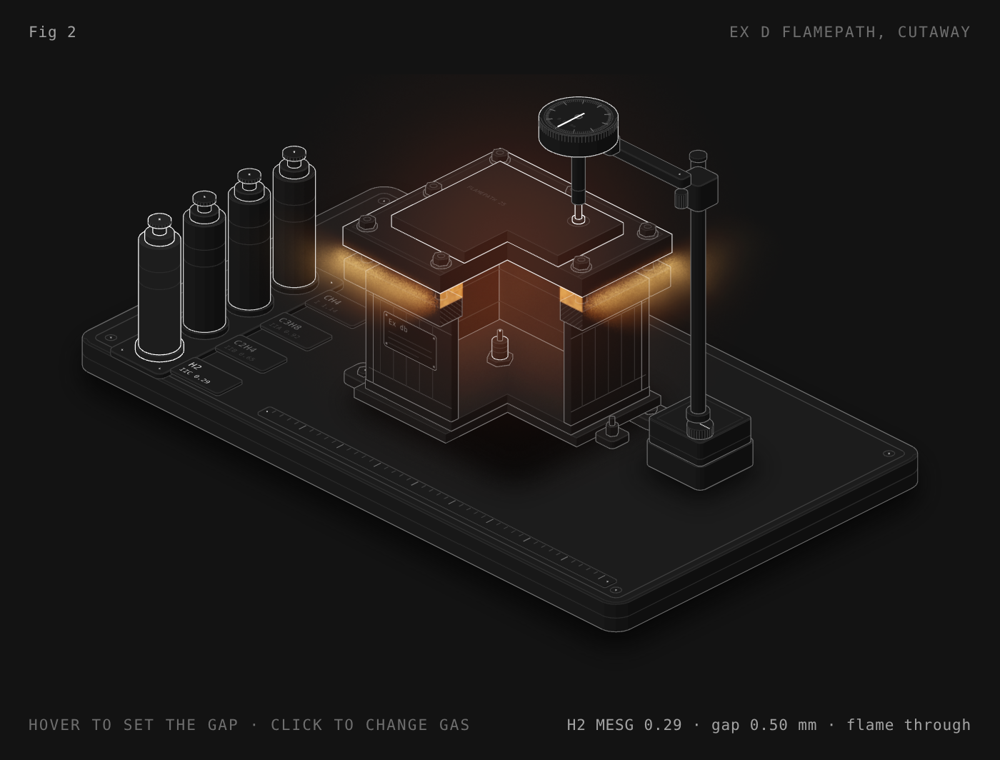
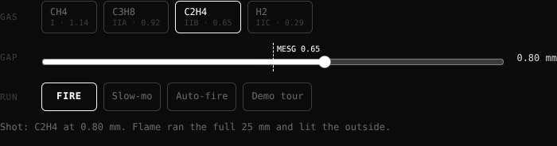

# Ex d flamepath

A little interactive toy that shows why a flameproof (Ex d) enclosure works: an explosion goes off inside the box, the flame tries to escape through the flange gap, and the joint either cools it down or it doesn't.

**[▶ Play with it](https://dizzyfer.github.io/anatomy/)** · [light version](https://dizzyfer.github.io/anatomy/light.html)

## What you can do

- **Pick a gas:** methane, propane, ethylene or hydrogen. Tap the buttons or the bottles on the bench.
- **Set the gap:** with the slider, or drag the box up and down. The dashed line (and the tick on the dial) is that gas's MESG.
- **FIRE:** the spark plug lights the gas inside. Watch the flame front run along the 25 mm joint in the cutaway.
  - Under MESG it dies in the joint and only cooled gas leaks out.
  - Over MESG it makes it through and lights up the outside.
- **Slow-mo** to watch the front crawl, **Auto-fire** to keep it popping while you play, **Demo tour** if you just want to watch.

Keyboard: arrows = gap (Shift for big steps), G = gas, Space = fire, S = slow-mo.

## The numbers

MESG values (maximum experimental safe gap) are the reference gases from IEC 60079-20-1: methane 1.14, propane 0.92, ethylene 0.65, hydrogen 0.29 mm. How far the flame gets into the joint before it dies is made up for the visual. The gap is drawn hugely enlarged. It's a toy, so don't design anything off it.

## How it's built

Built with [**Anatomy**](https://github.com/wheresryan22/anatomy) by Ryan (wheresryan22), an open-source kit for interactive isometric figures. Massive credit to him: the drawing kit, the isometric camera and the WebGL layer are all his work.

- `index.html` / `light.html` are fully self-contained. Open either one in a browser, no install needed.
- `src/build.mjs` is the source. To rebuild, clone Anatomy, drop it in as `examples/ex-d-flamepath/build.mjs`, and run `node build.mjs` (add `--light` for the light theme).

## Licence

MIT. See [LICENSE](LICENSE). The pages include the Anatomy kit, which is MIT-licensed © 2026 Ryan. Its notice is in the same file.
