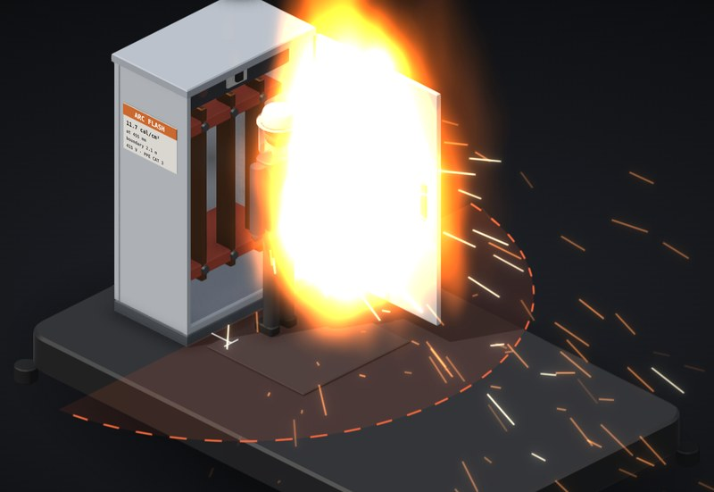

# Arc flash

A 415 V switchboard with the door open, a spanner left on the bar support, and you standing in front of it. Drop the spanner and see what you'd cop.

**[▶ Play with it](https://dizzyfer.github.io/Anatomy/arc-flash/)** · [light version](https://dizzyfer.github.io/Anatomy/arc-flash/light.html) · [all figures](https://dizzyfer.github.io/Anatomy/)

## How it works

1. **The spanner bridges two bars.** The arc vaporises copper, which expands thousands of times over and comes out of the front of the board as plasma, molten metal and a pressure wave.
2. **Three things decide how bad it is:** how much current the arc draws, how long it lasts before the protection clears it, and how far away you are.
3. **Energy is counted in cal/cm².** 1.2 is enough for a second-degree burn on bare skin. The **arc flash boundary** is how far out that 1.2 reaches, drawn on the floor.
4. **PPE is rated in the same units.** CAT 1 is 4, CAT 2 is 8, CAT 4 is 40. If the energy beats the rating, the gear doesn't save you. Above 40 there's no category: switch it off.
5. **Past 40 cal/cm², it's the blast as much as the heat.** The toy throws you clean out of your clothes and across the room, and leaves your boots behind.

## The one that catches people out

Time is the big lever. A breaker trips instantly above its instantaneous pickup, and waits out a time delay below it. So drop the fault level a bit and the arc current falls under the pickup: the breaker waits 0.4 s instead of 0.06 s, and **less fault current gives you far more energy**. 25 kA at 610 mm is about 1.5 cal/cm². 18 kA at 455 mm is about 11.7.

The maintenance mode switch fixes that by dropping the pickup while someone's working on it.

## What you can do

- **Fault level** (bolted, 5 to 60 kA), **Protection** (breaker, maintenance mode, upstream only), **Distance** (400 to 3000 mm), **Wearing** (work clothes, CAT 1, CAT 2, CAT 4).
- Energy meter with the 1.2 burn line and your PPE rating, arcing current, clearing time, boundary and the category it needs. The label on the board updates too.
- **DROP THE SPANNER** (or tap the board). Slow-mo and Demo tour like the others.

Keyboard: Space = drop, ← → = distance, ↑ ↓ = fault level, M = maintenance mode, S = slow-mo.

## The numbers

Real: the IEEE 1584-2002 empirical equations for under 1 kV (enclosed switchgear, solidly earthed, 32 mm gap, distance exponent 1.473, Cf 1.5), the 1.2 cal/cm² boundary, and the NFPA 70E PPE categories (4, 8, 25, 40 cal/cm²). Real studies use the newer IEEE 1584-2018 model and the actual protection curves.

Made up for the toy: the protection settings (10 kA instantaneous pickup, 0.06 s, 0.4 s, 1 s), the burn grading, when work clothes catch fire, the knockdown, the 40 cal/cm² launch and all the visuals. Don't label a board off it.

## How it's built

Built with [**Anatomy**](https://github.com/wheresryan22/anatomy) by Ryan (wheresryan22). To rebuild, drop `src/build.mjs` into Anatomy as `examples/arc-flash/build.mjs` and run `node build.mjs` (`--light` for the light theme).
