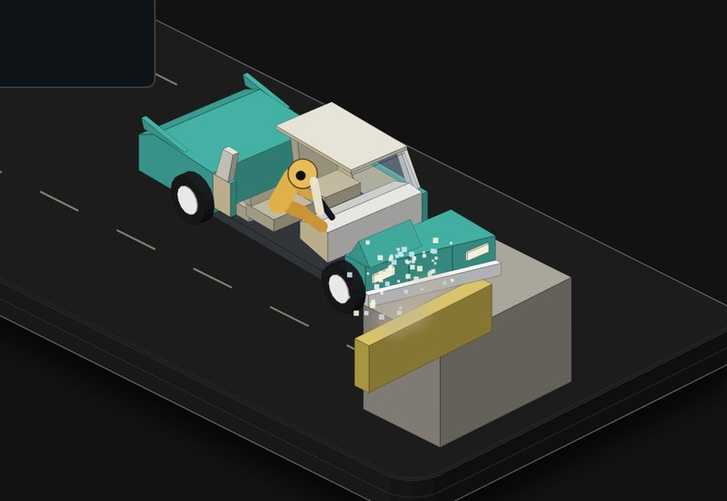

# Car crash

The same crash fifty years apart. A sedan hits an offset barrier, with the driver's side cut away so you can watch the crash dummy, the seatbelt, the airbag and the cabin. Pick a 1959-style or a 2009-style car, change the speed, take the belt off, and watch the g-trace.

**[▶ Play with it](https://dizzyfer.github.io/Anatomy/crash/)** · [light version](https://dizzyfer.github.io/Anatomy/crash/light.html) · [all figures](https://dizzyfer.github.io/Anatomy/)

## How it works

1. **Energy over distance.** A moving car carries ½mv² of energy, and a crash is getting rid of it. Stop over a metre and it's a few tens of g; stop over a few centimetres and it's hundreds.
2. **Crumple zone.** A modern car's front end is built to crush long and steady on purpose, so the slowing-down is spread over as much distance as possible.
3. **Safety cage.** Behind the crumple zone the cabin is stiff, so the firewall, footwell and steering column don't come back at the driver. The old car does it the other way round: a short front end, then the cabin folds.
4. **Belt and airbag.** The belt ties you to the car's slowing-down from the first few milliseconds. The airbag catches the head and chest for the last bit. Without them you keep going at the original speed until you hit the inside of the car.
5. **Offset hit.** Only the driver's side hits the barrier, so that side takes the crush and the car swings round.

## What you can do

- **Car:** 1959-style (big, chrome, no plan) or 2009-style (crumple zone and cage).
- **Speed** from 20 to 120 km/h. The IIHS test was 40 mph, about 64 km/h.
- **Seatbelt** and **airbag** on or off (the 1959 car has no airbag).
- Meters for chest g (60 g limit), head injury criterion (HIC 700 limit) and footwell intrusion, plus a live g-trace of the car and the chest.
- Crash, Even slower and Demo tour. One second on screen is 25 ms of crash.

Keyboard: space = crash, O / N = old or new car, B = belt, A = airbag, up/down = speed.

## The numbers

Real: ½mv² against crush distance, crumple zones and safety cages, belts and airbags, the 60 g chest and HIC 700 head limits (FMVSS 208), and the [IIHS test in 2009](https://classroom.iihs.org/?p=5678) of a 1959 Chevrolet Bel Air against a 2009 Chevrolet Malibu at 40 mph. The IIHS figures quoted in the figure (chest 85 g against 41 g, footwell intrusion 62 cm against 7 cm) are from its published crash data.

Made up: the cars, the force curves, the one-dimensional dummy, the head numbers and the injury labels. The barrier stands in for the other car. The model is tuned so the 64 km/h runs land near the IIHS chest and intrusion numbers.

## How it's built

Built with [**Anatomy**](https://github.com/wheresryan22/anatomy) by Ryan (wheresryan22). To rebuild, drop `src/build.mjs` and `src/solid.mjs` into Anatomy as `examples/crash/` and run `node build.mjs` (`--light` for the light theme).
