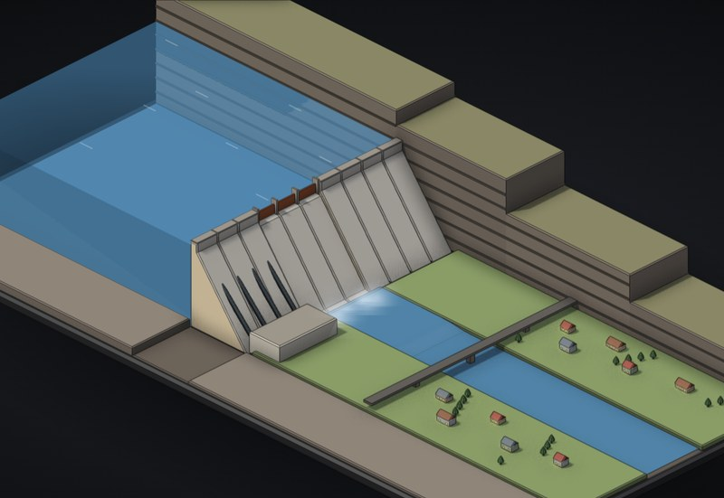

# Hydro dam

A 100 m concrete gravity dam making power, with a town downstream. Run the turbines, trip the grid, bring a flood, then jam the spillway and block the drains and watch it go.

**[▶ Play with it](https://dizzyfer.github.io/Anatomy/dam/)** · [light version](https://dizzyfer.github.io/Anatomy/dam/light.html) · [all figures](https://dizzyfer.github.io/Anatomy/)

## How it works

1. **Power is ρ·g·Q·H.** Water falls down the penstocks and spins the turbines: the flow times the fall (times about 0.92 efficiency) is the power.
2. **The dam holds by being heavy.** The lake pushes it sideways (½ρgH²), water seeping underneath pushes it up (uplift), and only friction under its own weight holds it in place. Drains in the foundation bleed the uplift off.
3. **Floods go over the spillway.** Radial gates pass the extra water. If they can't keep up, the lake goes over the crest and the falling water scours the rock at the toe.
4. **Load rejection.** When the grid trips, the turbines suddenly have nothing to push against. Close their gates too fast and the moving water slams into them (water hammer, enough to split a penstock); too slow and the unit overspeeds until the generator comes apart.
5. **The breach.** When the factor of safety drops below 1, monoliths slide off their foundation, the lake empties through the gap, and a flood wave (solved as shallow-water flow) goes down the valley.

## What you can do

- **River inflow:** dry, wet season, flood, or monster flood.
- **Turbines** and **spillway gates** sliders, and the turbine **closing time** after a trip.
- **Trip the grid**, **jam the gates**, **block the drains**.
- Meters for lake level, power, the sliding factor of safety, and the unit's speed and penstock pressure; homes powered, and the town's lights on or off.
- Rebuild, Slow-mo and Demo tour.

Keyboard: T = trip/reconnect, F = flood, G = gates, J = jam, D = drains, R = rebuild, S = slow-mo.

## The numbers

Real: P = ρgQH, the forces on a gravity dam and the sliding check, foundation drains against uplift, weir and gate flow, toe scour from overtopping, dam-break outflow, shallow-water flood waves, and water hammer (Joukowsky and Michaud) against overspeed after a load rejection. Real failures: St Francis (1928, a gravity dam that went at its foundation) and Teton (1976).

Made up for the toy: the dam and site, the tiny reservoir and sped-up time, every coefficient, the town, and failures tuned to happen on cue.

## How it's built

Mark II: drawn in real 3D with a small WebGL2 renderer (`mk2/engine.mjs` in this repo: soft shadows, ambient occlusion, ink outlines, bloom, x-ray), on top of the camera and page conventions of [**Anatomy**](https://github.com/wheresryan22/anatomy) by Ryan (wheresryan22). Drag to rotate, pinch or ctrl-scroll to zoom, double click to reset the view. To rebuild, copy this repo's `mk2/` folder into an Anatomy checkout, drop `src/build.mjs` in as `examples/dam/build.mjs` and run `node build.mjs` (`--light` for the light theme).
