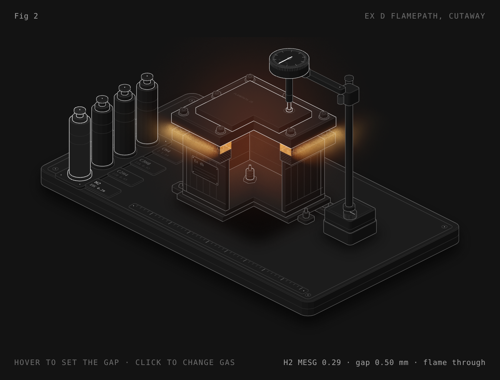
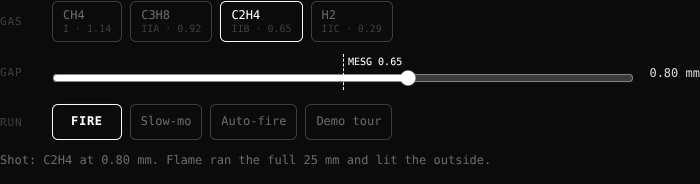

# Ex d flamepath

A little interactive toy that shows why a flameproof (Ex d) enclosure works: an explosion goes off inside the box, the flame tries to escape through the flange gap, and the joint either cools it down or it doesn't.

**[▶ Play with it](https://dizzyfer.github.io/Anatomy/ex-d-flamepath/)** · [light version](https://dizzyfer.github.io/Anatomy/ex-d-flamepath/light.html)

## What you can do

- **Pick a gas:** methane, propane, ethylene or hydrogen. Tap the buttons or the bottles on the bench.
- **Set the flamepath length:** below the notch the joint's too short to cool the flame, and it fails whatever the gap. The flange gets physically wider or narrower as you slide it.
- **Set the gap:** with the slider, or drag the box up and down. The dashed line (and the tick on the dial) is that gas's MESG.
- **FIRE:** the spark plug lights the gas inside. Watch the flame front run along the 25 mm joint in the cutaway.
  - Under MESG it dies in the joint and only cooled gas leaks out.
  - Over MESG it makes it through, lights the area, and the whole bench goes up: lid launched, bottles flattened. Then it resets for another go.
- **Slow-mo** to watch the front crawl, **Auto-fire** to keep it popping while you play, **Demo tour** if you just want to watch.

Keyboard: arrows = gap (Shift for big steps), G = gas, Space = fire, S = slow-mo.

## The numbers

MESG values (maximum experimental safe gap) are the reference gases from IEC 60079-20-1: methane 1.14, propane 0.92, ethylene 0.65, hydrogen 0.29 mm. The path-length notch and how far the flame gets into the joint before it dies are made up for the toy. The gap is drawn hugely enlarged. It's a toy, so don't design anything off it.

## How it's built

Mark II: drawn in real 3D with a small WebGL2 renderer (`mk2/engine.mjs` in this repo: soft shadows, ambient occlusion, ink outlines, bloom, x-ray), on top of the camera and page conventions of [**Anatomy**](https://github.com/wheresryan22/anatomy) by Ryan (wheresryan22). Drag to rotate, pinch or ctrl-scroll to zoom, double click to reset the view. To rebuild, copy this repo's `mk2/` folder into an Anatomy checkout, drop `src/build.mjs` in as `examples/ex-d-flamepath/build.mjs` and run `node build.mjs` (`--light` for the light theme).
