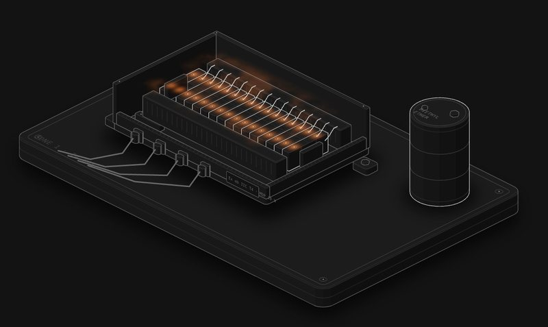

# Ex e: MDP and creepage

Ex e has no flamepath to save it. It works by never making a spark or a hot surface in the first place. This shows the two ways that goes wrong.

**[▶ Play with it](https://dizzyfer.github.io/Anatomy/ex-e-terminals/)** · [light version](https://dizzyfer.github.io/Anatomy/ex-e-terminals/light.html) · [all figures](https://dizzyfer.github.io/Anatomy/)

## What you can do

- **Heat (MDP):** set how many circuits are populated and the current per circuit. Every circuit dissipates I²R. The meter shows that against the box's maximum dissipated power.
  - Hit **ENERGISE** and the box warms up. Over MDP, the surface goes past T4's 135 °C. Keep going, past the ether's ignition temperature, and it goes up.
- **Insulation:** set the working voltage and pick a **Clean** or **Dusty & damp** surface.
  - **Creepage** (along the surface) hates dirt. Over the limit, a carbon track crawls across the plastic between two terminals until it bridges and arcs.
  - **Clearance** (through air) doesn't care how clean it is. Over the limit, it flashes over straight away.
- Drag up and down on the box for current, tap it to switch on and off. Slow-mo and Demo tour like the others.

Keyboard: up/down = amps, left/right = volts, +/- = circuits, D = dirty, Space = energise, S = slow-mo.

## The numbers

Real: T4 is 135 °C max surface, and diethyl ether (a T4 gas) autoignites at about 160 °C.

Made up for the toy: 2.5 mΩ per circuit, a 10 W MDP that sits exactly at 135 °C, and the creepage (550 V clean, 230 V dirty) and clearance (800 V) limits. Real figures come off the box and terminal certificates and the IEC 60079-7 tables. Don't design anything off it.

## How it's built

Built with [**Anatomy**](https://github.com/wheresryan22/anatomy) by Ryan (wheresryan22). To rebuild, drop `src/build.mjs` into Anatomy as `examples/ex-e-terminals/build.mjs` and run `node build.mjs` (`--light` for the light theme).

MIT. See [LICENSE](../LICENSE).
