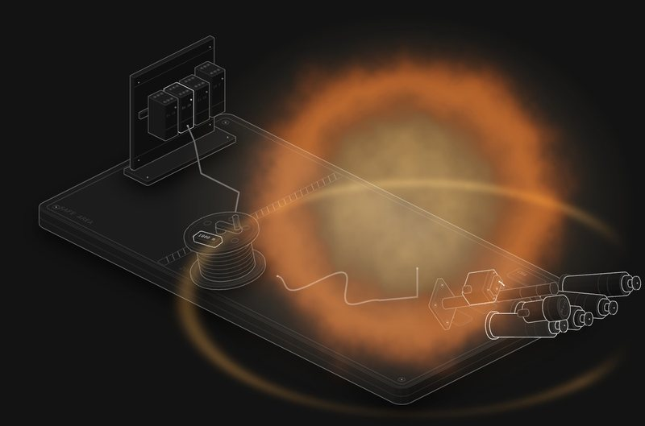

# Ex i: cable length

Why an intrinsically safe loop can stop being safe just by being longer.

**[▶ Play with it](https://dizzyfer.github.io/Anatomy/ex-i-spark/)** · [light version](https://dizzyfer.github.io/Anatomy/ex-i-spark/light.html) · [all figures](https://dizzyfer.github.io/Anatomy/)

## What you can do

- **Pick a gas:** methane, propane, ethylene or hydrogen. Tap a button or a bottle.
- **Set the barrier voltage:** 6 to 30 V.
- **Pay out cable:** 0 to 5000 m, with the slider or by dragging sideways on the bench. The drum unwinds and the cable piles up in loops.
- **BREAK WIRE:** the conductor lifts off its terminal in the junction box and sparks. The spark energy is the cable's stored charge, ½CV².
  - Under the gas's minimum ignition energy it fizzles.
  - Over it, Zone 1 goes up. The safe area doesn't flinch.

The **Spark** meter shows the energy against the gas's MIE. Keyboard: left/right = cable, up/down = volts, G = gas, Space = break the wire, S = slow-mo.

## The numbers

- Cable capacitance: 200 pF/m, the figure IEC 60079-25 lets you assume for ordinary 2/3-core cable when you don't have the real one.
- Minimum ignition energies: methane 280, propane 250, ethylene 70, hydrogen 17 µJ.
- At 24 V, hydrogen goes somewhere around 300 m. Propane holds out past 4 km.

It's a toy. Real IS checks use the standard's ignition curves with safety factors, cable inductance and the field device's own parameters, not raw MIE. Don't design a loop off it.

## How it's built

Built with [**Anatomy**](https://github.com/wheresryan22/anatomy) by Ryan (wheresryan22). To rebuild, drop `src/build.mjs` into Anatomy as `examples/ex-i-spark/build.mjs` and run `node build.mjs` (`--light` for the light theme).

MIT. See [LICENSE](../LICENSE).
