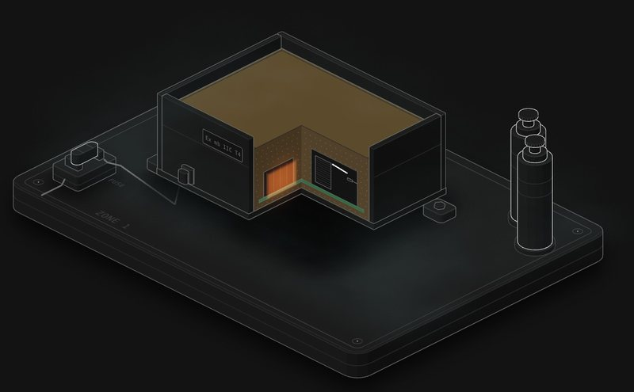

# Ex m: encapsulation

Ex m doesn't stop the sparks. It buries them. Parts that spark or run hot sit in solid compound, so the gas never gets to them. This shows the sparks happily going off inside, and the ways to let the gas in.

**[▶ Play with it](https://dizzyfer.github.io/Anatomy/ex-m-potted/)** · [light version](https://dizzyfer.github.io/Anatomy/ex-m-potted/light.html) · [all figures](https://dizzyfer.github.io/Anatomy/)

## What you can do

- **SWITCH:** the relay clicks away and its contacts spark, right there in the cutaway. Nothing happens, because the gas can't reach them.
- **Cover:** how much compound sits over the parts. Below the notch the pour is too thin. As it heats and cools a crack works its way down from the surface to the relay, the gas follows it in, and the next contact spark lights it.
- **Load:** how hard the parts are worked. The Parts °C meter shows their temperature against the compound's limit. Run past it and the compound degrades and splits, with the same ending.
- **Fuse + FAULT:** Ex m relies on an upstream fuse to cap fault current. Hit FAULT for a short circuit:
  - **Fitted:** the fuse pops, the module goes dead, everyone lives.
  - **Missing:** the resistor cooks, the compound splits open and it goes up.
- Drag up and down on the module for load, tap it to switch. Slow-mo and Demo tour like the others.

Keyboard: up/down = load, left/right = cover, F = fuse, X = fault, Space = switch, S = slow-mo.

## The numbers

None of them. The idea is real (IEC 60079-18: encapsulation, minimum compound thickness, the compound's temperature limit, and fuse protection), but the thicknesses, temperatures and timings are made up to show it. Real values come off the certificate. Don't design anything off it.

## How it's built

Built with [**Anatomy**](https://github.com/wheresryan22/anatomy) by Ryan (wheresryan22). To rebuild, drop `src/build.mjs` into Anatomy as `examples/ex-m-potted/build.mjs` and run `node build.mjs` (`--light` for the light theme).

MIT. See [LICENSE](../LICENSE).
