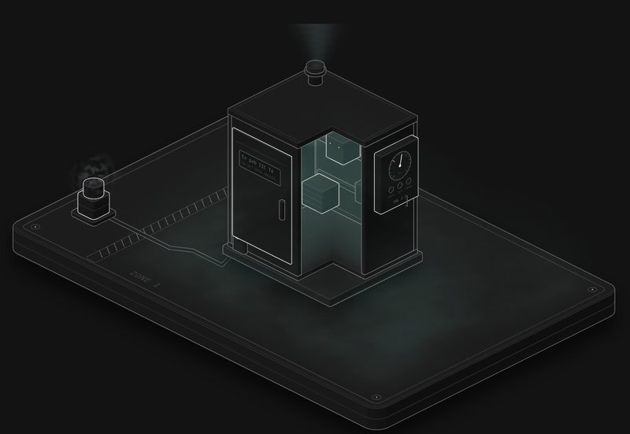

# Ex p: purge and pressure

Ex p lets you put ordinary sparking kit in Zone 1 by keeping the gas out with clean air. This shows how that works, and four ways to get it wrong.

**[▶ Play with it](https://dizzyfer.github.io/Anatomy/ex-p-purge/)** · [light version](https://dizzyfer.github.io/Anatomy/ex-p-purge/light.html) · [all figures](https://dizzyfer.github.io/Anatomy/)

## How it works

1. **Purge.** A cabinet that's been sitting in Zone 1 switched off is full of the zone's gas. Clean air goes in at the bottom and pushes the gas out of the vent at the top. Air never mixes perfectly, so the standard asks for at least **five** of the cabinet's own volumes.
2. **Pressurise.** Then the cabinet is held at **50 Pa or more** above the zone, so anything that leaks, leaks out.
3. **Power.** Only then does the interlock allow power on. For px, if the pressure drops, the interlock **cuts the power**, and it stays off until a fresh purge.

The contactor inside sparks every time it switches. With the gas kept out, that's harmless.

## Four ways to kill it

- **Power before the purge** (interlock bypassed): the first spark lights the cabinet full of gas.
- **Open the door live** with the interlock working: it trips. That's px doing its job.
- **Open the door live** with the interlock bypassed: the pressure goes, the gas seeps back in, nothing cuts the power.
- **Intake in the zone:** the interlock sees the pressure and counts five volumes, and it's completely happy. But it can't smell the air: you've purged the cabinet with the zone's own gas. Purge air has to come from the safe area.

## What you can do

- **Intake:** safe area or in the zone. **Interlock:** working or bypassed.
- **PURGE**, **POWER ON**, **Open door** (or tap the cabinet). Meters for pressure (50 Pa mark), volumes purged (5 mark) and gas inside (LEL mark). The controller on the side has the gauge, the volume counter and PURGED / TRIP / POWER lamps.
- Slow-mo and Demo tour like the others.

Keyboard: A = purge, P or Space = power, D = door, I = intake, L = interlock, S = slow-mo.

## The numbers

Real (IEC 60079-2, px): at least 50 Pa overpressure, a pre-purge of at least five enclosure volumes, power off on loss of pressure until a fresh purge, and purge air from the safe area.

Made up for the toy: the gas levels, how well the air mixes, the flow and the timings. Don't design anything off it.

## How it's built

Built with [**Anatomy**](https://github.com/wheresryan22/anatomy) by Ryan (wheresryan22). To rebuild, drop `src/build.mjs` into Anatomy as `examples/ex-p-purge/build.mjs` and run `node build.mjs` (`--light` for the light theme).

MIT. See [LICENSE](../LICENSE).
