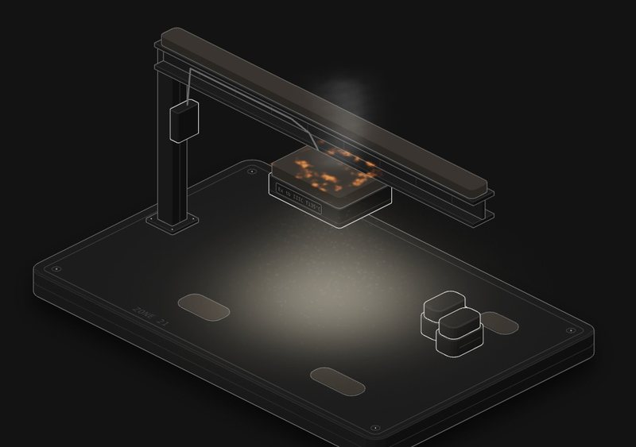

# Ex t: dust on the light

Why the 5 mm in a dust rating matters, and why housekeeping is safety equipment.

**[▶ Play with it](https://dizzyfer.github.io/Anatomy/ex-t-dust/)** · [light version](https://dizzyfer.github.io/Anatomy/ex-t-dust/light.html) · [all figures](https://dizzyfer.github.io/Anatomy/)

## What you can do

- **Pick a dust:** coal, wood flour or sugar. Each has its own layer and cloud ignition temperatures.
- **Layer:** pile dust on the light and the beam, 0 to 30 mm, with the slider or by dragging up and down. The 5 mm rule is marked. The fins disappear under the layer.
- **LIGHT ON:** the floodlight warms up. The Under layer meter shows the temperature under the dust against three marks:
  - the light's **T135** marking,
  - the dust's **limit** (the lower of ⅔ × cloud ignition temperature and the layer ignition temperature − 75 K),
  - where **this layer lights**. That mark creeps down as the layer gets thicker.
- **Too thick:** the dust insulates the light, it runs hotter underneath, and eventually the layer **smoulders**. No flame, no bang. Yet.
- **KNOCK:** something bumps the column and shakes dust loose into a cloud.
  - No smoulder: the cloud drifts and settles. A T135 light can't light a cloud that needs 500–600 °C.
  - Smouldering: the smoulder lights the cloud (the **primary**), and that blast shakes the dust off the beam into a much bigger **secondary** explosion.
- **Clean:** housekeeping. Slow-mo and Demo tour like the others.

Keyboard: up/down = layer, L = light, Space = knock, C = clean, G = dust, S = slow-mo.

## The numbers

Real: the IEC 60079-14 rule for dust (Tmax = the lower of ⅔ × cloud ignition temperature and 5 mm layer ignition temperature − 75 K, and that rule only covers layers up to 5 mm), and literature ignition temperatures (5 mm layer / cloud): coal 250 / 600 °C, wood flour 340 / 490 °C, sugar 480 / 490 °C.

Made up for the toy: how hot the light runs under the dust (it hits its T135 marking at exactly 5 mm), how much a thicker layer drops its ignition temperature, and all the timings. Real dust data comes from testing the actual dust. Don't design anything off it.

## How it's built

Built with [**Anatomy**](https://github.com/wheresryan22/anatomy) by Ryan (wheresryan22). To rebuild, drop `src/build.mjs` into Anatomy as `examples/ex-t-dust/build.mjs` and run `node build.mjs` (`--light` for the light theme).

MIT. See [LICENSE](../LICENSE).
