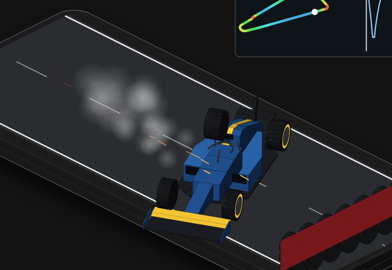

# F1 car

A 2026-style Formula 1 car lapping a made-up circuit. Watch the air go over it, the downforce on each axle, the wing flaps opening on the straights and the front brakes glowing. Then follow another car through its dirty air, tape over the brake ducts, or snap the rear wing off at 340 km/h.

**[▶ Play with it](https://dizzyfer.github.io/Anatomy/f1/)** · [light version](https://dizzyfer.github.io/Anatomy/f1/light.html) · [all figures](https://dizzyfer.github.io/Anatomy/)

## How it works

1. **Grip.** The tyres can only push sideways or backwards so hard, roughly in proportion to how hard they're pressed into the track.
2. **Downforce.** The wings and the floor press the car into the track with a force that grows with speed squared. In fast corners that's most of the grip.
3. **Drag.** Downforce costs drag. The 2026 cars flatten their front and rear wing flaps on the straights (Straight Mode) and close them for corners and braking (Corner Mode). DRS is gone.
4. **Power.** About 400 kW of engine and 350 kW of MGU-K. The electric push tapers off at high speed, unless you're within a second of the car ahead (Overtake Mode).
5. **Brakes.** Stopping from over 300 km/h at around 5 g. The MGU-K harvests some of it and the carbon discs take the rest, running past 1,000 °C.
6. **Dirty air.** Close behind another car the front wing gets turbulent air: less front grip, slower corners and overheating front tyres.

## What you can do

- **Wing level** from Monza (low drag) to Monaco (high downforce).
- **Active aero** on, or stuck in Corner Mode.
- **Traffic:** clean air, 1 s behind, or 0.4 s behind.
- **Break it:** tape over the brake ducts (the discs cook and fail), or snap the rear wing (it lets go at speed and the car spins at the next braking zone).
- Meters for speed, downforce (against the car's weight), brake disc and front tyre temperature; lap time, top speed, peak g. A track map and speed trace inset.
- Reset, Slow-mo and Demo tour.

Keyboard: up/down = wing level, A = active aero, F = traffic, D = brake ducts, W = snap the rear wing, R = reset.

## The numbers

Real: downforce and drag growing with speed squared, the 2026 rules (Straight Mode and Corner Mode active aero instead of DRS, about 400 kW of engine and 350 kW of MGU-K tapering off at high speed, Overtake Mode within a second of the car ahead, a 768 kg minimum weight), carbon brakes past 1,000 °C, braking at around 5 g, dirty air, and Grosjean's 67 g impact at 192 km/h in Bahrain in 2020 (FIA).

Made up: the circuit, the car and its livery, the aero, tyre and power-taper numbers, the brake and tyre heat models, the failures and the crash. The track scrolls slower than real so you can see it.

## How it's built

Built with [**Anatomy**](https://github.com/wheresryan22/anatomy) by Ryan (wheresryan22). To rebuild, drop `src/build.mjs` and `src/solid.mjs` into Anatomy as `examples/f1/` and run `node build.mjs` (`--light` for the light theme).
