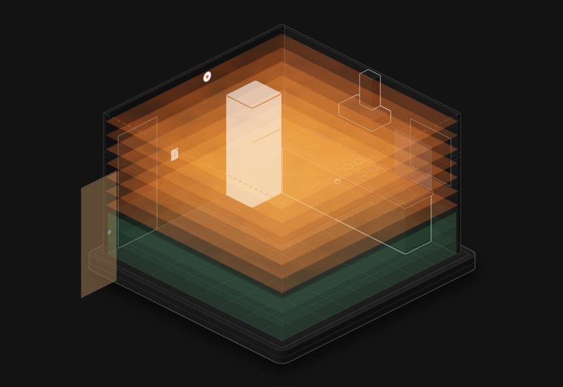

# Gas leak in the kitchen

A kitchen cut open with the gas left on. Watch it fill the room in layers, then flick the light switch, let the fridge kick in, or hit the igniter.

**[▶ Play with it](https://dizzyfer.github.io/Anatomy/gas-leak/)** · [light version](https://dizzyfer.github.io/Anatomy/gas-leak/light.html) · [all figures](https://dizzyfer.github.io/Anatomy/)

## How it works

1. **Gas only burns in a band.** Too little and there isn't enough fuel, too much and there isn't enough air. Methane burns between 5 and 15 %, propane between about 2.1 and 9.5 %.
2. **It layers.** Natural gas is lighter than air and fills the room from the ceiling down. LPG is heavier and fills it from the floor up. That's why natural gas detectors go up high and LPG ones go down low.
3. **You'll smell it first.** Gas is odourised so you can smell it at about a fifth of the lower limit, well before it can burn.
4. **The spark has to be in the layer.** A light switch at chest height, a fridge thermostat near the floor. Spark outside the flammable layer and nothing happens. Spark inside it and the whole layer goes at once.
5. **Too rich isn't safe either.** A layer above the upper limit won't burn, but it becomes flammable again the moment you start airing it out.

The layers show green (too lean), orange (flammable) and purple (too rich).

## What you can do

- **Gas:** natural gas or LPG. **Leak:** burner left on or the hose off. **Air:** all shut, window open, range hood on. **Detector:** up high or down low.
- Meters for the concentration at the ceiling, at the light switch and at the floor, with the LEL and UEL marks.
- **LEAVE THE GAS ON**, then **Flick the light**, **Fridge kicks in** or **Igniter**. Tap the room to flick the light. Reset, Slow-mo and Demo tour like the others.

Keyboard: G = gas on/off, Space = light switch, F = fridge, C = igniter, L = gas type, W = ventilation, D = detector, R = reset, S = slow-mo.

## The numbers

Real: the flammable ranges, which gas rises and which sinks, odourising to about a fifth of the LEL, and where the detectors go.

Made up for the toy: the room, the leak rates, how it layers and mixes, the ventilation rates, the alarm level, the time-lapse (two and a half minutes a second) and the blast. If you smell gas: don't touch a switch, get out, and call it in from outside.

## How it's built

Built with [**Anatomy**](https://github.com/wheresryan22/anatomy) by Ryan (wheresryan22). To rebuild, drop `src/build.mjs` into Anatomy as `examples/gas-leak/build.mjs` and run `node build.mjs` (`--light` for the light theme).
