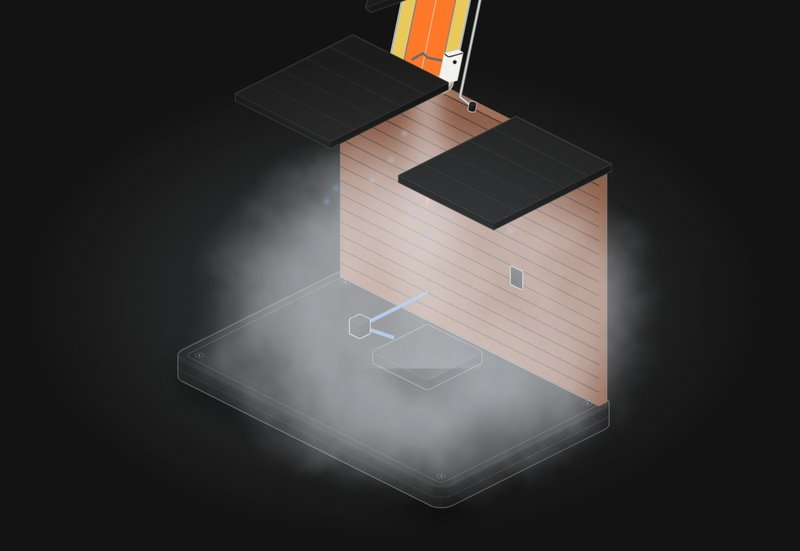

# Hot water system

An electric storage hot water system against the house wall, cut open. Break the thermostat, weld the cutout, cap the relief valve, and send it through the roof.

**[▶ Play with it](https://dizzyfer.github.io/Anatomy/hot-water/)** · [light version](https://dizzyfer.github.io/Anatomy/hot-water/light.html) · [all figures](https://dizzyfer.github.io/Anatomy/)

## How it works

1. **Pressure raises the boiling point.** Under pressure, water stays liquid well past 100 °C: about 178 °C at 850 kPa, about 224 °C at 2400 kPa.
2. **That's the danger.** If the tank fails, the pressure drops to nothing in an instant and every bit of water above 100 °C flashes to steam at once, around 1600 times its volume. The fraction that flashes is cp·(T − 100)/hfg: about a fifth of the tank at 220 °C.
3. **Three things stand in the way:** the thermostat (65 °C here), the over-temperature cutout (85 °C), and the temperature and pressure relief valve (850 kPa and 99 °C).

## Why the T in T&PR matters

- **Proper T&PR:** at 99 °C it dumps hot water and lets cold in, so the water never gets above boiling. Even a burst tank is just a flood.
- **Pressure-only valve:** it holds 850 kPa, so the tank won't burst, but the water carries on to 178 °C and sits there boiling. A tank of water 78 °C over boiling, waiting for something to fail.
- **Blocked valve:** nothing relieves it. Pressure and temperature climb together until the tank lets go, and it goes through the roof.
- **Corroded tank:** it gives up at a lower pressure, so a smaller (but still nasty) burst.

A bit of dribble from the drain while it heats is normal: that's the water expanding.

## What you can do

- **Thermostat:** working or stuck on. **Cutout:** working or welded shut. **Relief valve:** T&PR, pressure only, or blocked. **Tank:** sound or corroded.
- Meters for water temperature and pressure, plus the boiling point at that pressure and how many kg would flash to steam if it let go now.
- Power, Reset, Slow-mo and Demo tour like the others. Tap the tank to cycle the relief valve.

Keyboard: Space = power, T = thermostat, E = cutout, V = relief valve, C = tank, R = reset, S = slow-mo.

## The numbers

Real: T&PR valves set at a pressure (850 kPa here) and 99 °C (AS 1357.1), water's boiling point against pressure (Antoine fit), and the flash fraction. Typical: 250 L, 3.6 kW, 500 kPa mains, a 65 °C thermostat.

Made up for the toy: the thermal expansion pressure rise, the burst pressures, the time-lapse (about 50 minutes a second) and how high it flies. Never cap or block a relief drain.

## How it's built

Built with [**Anatomy**](https://github.com/wheresryan22/anatomy) by Ryan (wheresryan22). To rebuild, drop `src/build.mjs` into Anatomy as `examples/hot-water/build.mjs` and run `node build.mjs` (`--light` for the light theme).
