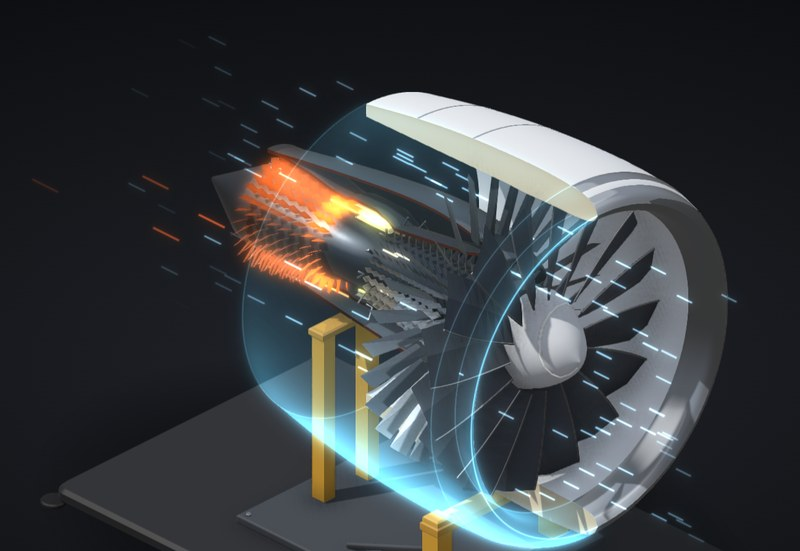

# Jet engine

A GE9X-sized turbofan, the biggest airliner engine built, cut in half on a test stand. Throttle it up, then feed it a goose, a flock, a fan blade or too much fuel.

**[▶ Play with it](https://dizzyfer.github.io/Anatomy/jet/)** · [light version](https://dizzyfer.github.io/Anatomy/jet/light.html) · [all figures](https://dizzyfer.github.io/Anatomy/)

## How it works

1. **A small jet driving a giant fan.** Air comes in the front. About ten parts in eleven go round the outside through the bypass duct; the rest goes into the core.
2. **The core.** The 3-stage booster and the 11-stage high-pressure compressor squeeze it 60 to 1, the combustor burns fuel in it, then the 2-stage high-pressure turbine (driving the compressor) and the 6-stage low-pressure turbine (driving the fan) take the energy back out.
3. **The bypass makes the thrust.** The big, slow, cold bypass flow makes most of the thrust. Bigger fans and higher bypass are how engines got more efficient.
4. **Certification.** A fan blade released at full power has to stay inside the fan case, and the engine has to take bird strikes without becoming a hazard.

## What you can do

- **Throttle** from idle to take-off (about 445 kN), or the **record run** (597 kN).
- **Afterburner:** fuel sprayed into the exhaust and lit, with shock diamonds. No airliner engine has one (Concorde aside), so this one's pure toy: about half as much thrust again for three to four times the fuel.
- **FADEC off / Firewall it:** take the limits away and push past the EGT limit until the HP turbine lets go.
- **Goose:** one bird at take-off power. Feathers out the bypass, a nick in the fan, it keeps running.
- **Flock:** six geese. Surges with flames out both ends, then it gets shut down.
- **Surge:** a compressor stall on demand.
- **Blade-off:** the containment test. A fan blade released at full power hits the case, the case holds, the engine's scrap.
- Meters for N1, EGT, thrust and vibration; thrust in lbf, tonnes and Hiluxes. Labels, New engine, Slow-mo and Demo tour.

Keyboard: up/down = throttle, A = afterburner, G = goose, F = flock, B = blade-off, S = slow-mo.

## The numbers

Real (GE9X, from [GE Aerospace](https://www.geaerospace.com/commercial/aircraft-engines/ge9x) and [Key Aero](https://key.aero/es/node/5576)): 3.4 m (134 in) fan, 16 carbon-fibre composite blades, 3-stage booster, 11-stage HPC at 27:1, CMC combustor liners, 2-stage HPT, 6-stage TiAl LPT, bypass about 10:1, overall pressure ratio 60:1, about 100,000 lbf (445 kN) take-off, and the 134,300 lbf (597 kN) record. Also real: the blade-off containment test and bird ingestion requirements.

Made up for the toy: the afterburner (not a thing on this engine), spool times, EGT numbers and the limit, the thrust curve, how the failures play out, the stand, and simplified internal proportions.

## How it's built

Built with [**Anatomy**](https://github.com/wheresryan22/anatomy) by Ryan (wheresryan22). To rebuild, drop `src/build.mjs` into Anatomy as `examples/jet/build.mjs` and run `node build.mjs` (`--light` for the light theme).
