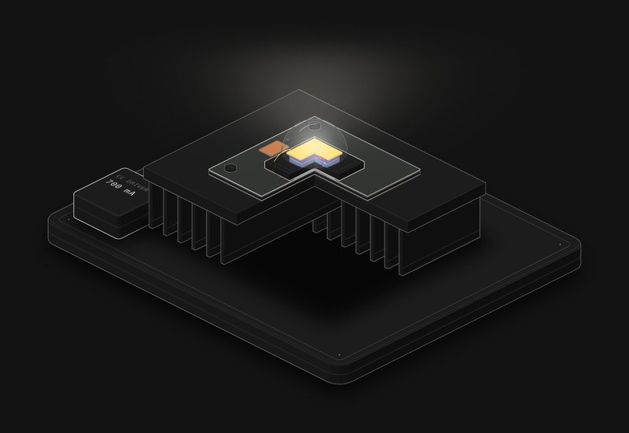

# How an LED works

A power LED on its board and heatsink, cut open. Push current through it, watch the voltage, the light and the heat, then feed it the wrong way and kill it.

**[▶ Play with it](https://dizzyfer.github.io/Anatomy/led/)** · [light version](https://dizzyfer.github.io/Anatomy/led/light.html) · [all figures](https://dizzyfer.github.io/Anatomy/)

## How it works

1. **Current makes the light.** Electrons and holes meet in the quantum wells in the die and give off blue photons. The yellow phosphor turns some of that blue into the rest of the white. More current, more light.
2. **Voltage is just what it costs.** An LED's forward voltage barely moves: about 2.8 V near nothing, about 3 V at 700 mA. Tiny voltage change, huge current change.
3. **Most of the power becomes heat.** Even a good LED turns well over half its input into heat at the die. That heat has to get out through the solder, the board, the paste and the heatsink, and every layer adds a few degrees.
4. **Hot LEDs drop their voltage.** About 2 mV per °C. That's the trap.

## Why you drive them with current, not voltage

On a **constant current (CC)** driver you set 700 mA and you get 700 mA, whatever this particular LED's voltage is.

On a **constant voltage (CV)** supply the current is whatever the LED decides. Set 3.12 V and three LEDs off the same reel give you roughly 560, 1000 and 1500 mA, depending on their Vf bin. And it gets worse: more current, more heat, lower Vf, even more current. On a weak heatsink that runs away until a bond wire lets go.

## What you can do

- **Drive:** CC (mA slider) or CV (volts slider). **Vf bin:** low, typical, high.
- **Heatsink:** proper, small, none. **Paste:** applied or forgotten. **Ambient** temperature.
- Meters for current (1500 mA max mark) and junction temperature (150 °C max mark), plus volts, watts, lumens, lm/W and how much is heat.
- **Thermal view** colours the cut faces by temperature. **Zoom to the die** (or tap it) shows the carriers and photons.
- **New LED** after you kill one. Slow-mo and Demo tour like the others.

Keyboard: ↑ ↓ = drive, M = CC/CV, T = thermal, Z = zoom, Space = on/off, R = new LED, S = slow-mo.

## The numbers

Real, from the Cree XP-G datasheet: 2.9 V typical at 350 mA, 1500 mA max, 4 °C/W junction to solder point, 150 °C max junction, about −2.1 mV/°C.

Made up for the toy: the board, paste and heatsink thermal resistances, the efficiency and droop curve, the bin spread, how fast it heats, and exactly when it dies. Don't design a luminaire off it.

## How it's built

Built with [**Anatomy**](https://github.com/wheresryan22/anatomy) by Ryan (wheresryan22). To rebuild, drop `src/build.mjs` into Anatomy as `examples/led/build.mjs` and run `node build.mjs` (`--light` for the light theme).
