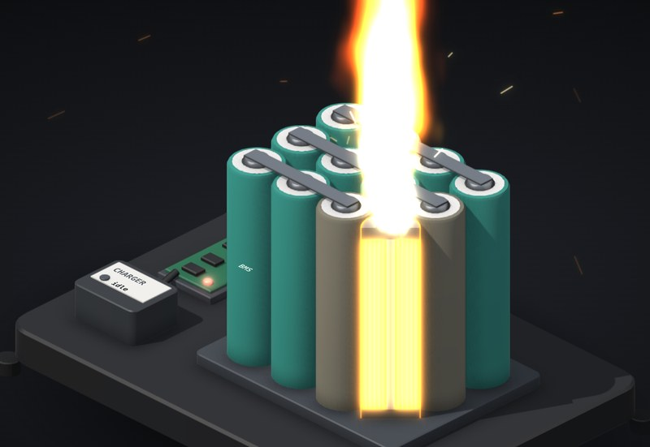

# Lithium thermal runaway

Twelve 18650 cells in a pack, one cut in half so you can see the roll inside. Overcharge it, put a nail through it or cook it, and watch whether it takes the rest of the pack with it.

**[▶ Play with it](https://dizzyfer.github.io/Anatomy/lithium/)** · [light version](https://dizzyfer.github.io/Anatomy/lithium/light.html) · [all figures](https://dizzyfer.github.io/Anatomy/)

## How it goes

A cell is a rolled-up sandwich of anode (copper), separator (white), cathode (grey) and separator again, soaked in a flammable electrolyte. Heat it and it goes through stages:

1. **About 80 °C:** the SEI, the film protecting the anode, starts breaking down. The electrolyte attacks the graphite and makes its own heat.
2. **About 130 °C:** the separator melts. Anode meets cathode: an internal short dumping the cell's own energy into itself.
3. **The vent pops:** electrolyte vapour and gas, flammable.
4. **Runaway:** around 150 to 200 °C for NMC, about 250 °C for LFP. The cathode gives up its oxygen and the electrolyte burns with it. It doesn't need air and you can't smother it. NMC hot spots get to around 800 °C.

## What decides how bad it is

- **The BMS** can stop an overcharge, and nothing else. A nail or a fire doesn't care about it.
- **Chemistry:** LFP runs away later and cooler, so it rarely takes its neighbours.
- **State of charge:** less charge, less energy. At 30 % a nail mostly just makes it hot, which is why cells ship at 30 % or less.
- **Spacing:** touching cells pass the heat straight across and it walks through the pack. A gap slows it down, which buys time. A barrier stops it.

## What you can do

- **Chemistry:** NMC or LFP. **Abuse:** overcharge, nail, heat. **BMS:** working or dead. **Spacing:** touching, gapped, barrier. **Charge:** 10 to 100 %.
- Meters for the hottest cell (130 and runaway marks) and the corner cell's voltage (max charge mark), plus how many cells have vented and run away. The cans go orange as they heat up, and the cut cell's layers change as each stage hits.
- **CHARGE IT / NAIL IT / HEAT IT** (or tap the pack), Reset, Slow-mo and Demo tour like the others.

Keyboard: Space = go, 1 2 3 = abuse, L = chemistry, B = BMS, R = reset, S = slow-mo.

## The numbers

Roughly real, and it varies a lot from cell to cell: SEI breakdown from about 70 to 90 °C, PE separators melting around 130 to 140 °C, runaway around 150 to 200 °C for nickel and cobalt cathodes and about 250 °C for LFP, hot spots near 800 °C, 4.2 V max for NMC and about 3.6 V for LFP, and less charge meaning less energy. See Kong, Li, Jiang and Pecht, *Li-Ion Battery Fire Hazards and Safety Strategies*, Energies 2018.

Made up for the toy: every rate, the heat model, how it spreads, the overcharge curve and the timings (squashed so you don't wait an hour). Don't design a pack off it.

## How it's built

Mark II: drawn in real 3D with a small WebGL2 renderer (`mk2/engine.mjs` in this repo: soft shadows, ambient occlusion, ink outlines, bloom, x-ray), on top of the camera and page conventions of [**Anatomy**](https://github.com/wheresryan22/anatomy) by Ryan (wheresryan22). Drag to rotate, pinch or ctrl-scroll to zoom, double click to reset the view. To rebuild, copy this repo's `mk2/` folder into an Anatomy checkout, drop `src/build.mjs` in as `examples/lithium/build.mjs` and run `node build.mjs` (`--light` for the light theme).
