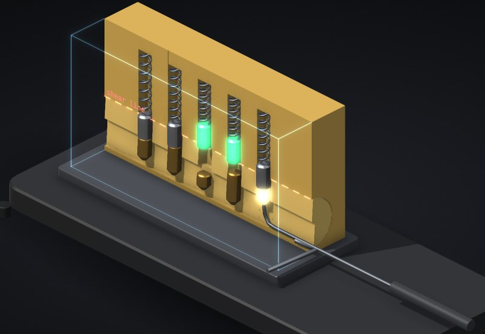

# How a lock gets picked

A pin tumbler lock cut in half lengthways, with a pick and a tension wrench in the keyway. Use the key, or drag the pins up yourself and pick it.

**[▶ Play with it](https://dizzyfer.github.io/Anatomy/lock/)** · [light version](https://dizzyfer.github.io/Anatomy/lock/light.html) · [all figures](https://dizzyfer.github.io/Anatomy/)

## How it works

1. **The shear line.** The plug can't turn because pin stacks (key pin below, driver pin above, spring on top) cross the gap between the plug and the housing.
2. **The key** lifts each stack so the gap between its key pin and driver pin sits exactly on the shear line. Then nothing crosses it and the plug turns.
3. **Picking** works because nothing's machined perfectly. Put a little turning force on the plug and one pin binds before the others. Lift it until its gap reaches the shear line and the driver catches on the plug's ledge: a set pin. Then the next one binds.

## Ways to get it wrong

- **No tension:** pins just spring up and down and nothing sets.
- **Too much tension:** the binding pin jams and won't lift.
- **Keep shoving after the click:** an overset. The key pin follows the driver up past the shear line and jams. Lift until it clicks, then stop. Drop the tension to start again.
- **Security pins:** spool-shaped drivers catch early and give a false set. Ease the tension so the plug counter-rotates, and lift a touch more.

## What you can do

- **Drag a pin up** on the lock itself, or pick it with the pin buttons and the Lift slider. **Tension** on the wrench.
- **Pins:** standard or security. **Rake it**, use **the key** or **the wrong key**, **New lock** (new pin lengths and binding order).
- Slow-mo and Demo tour like the others.

Keyboard: ← → = pin, ↑ ↓ = lift, T / G = more / less tension, R = rake, K = key, N = new lock, S = slow-mo.

## The numbers

There aren't really any. The mechanism is real: pin stacks across a shear line, binding from machining tolerance, setting, oversetting, spool pins and false sets, raking. Every dimension, tolerance and how much tension is too much is made up. Only pick locks you own.

## How it's built

Mark II: drawn in real 3D with a small WebGL2 renderer (`mk2/engine.mjs` in this repo: soft shadows, ambient occlusion, ink outlines, bloom, x-ray), on top of the camera and page conventions of [**Anatomy**](https://github.com/wheresryan22/anatomy) by Ryan (wheresryan22). Drag to rotate, pinch or ctrl-scroll to zoom, double click to reset the view. To rebuild, copy this repo's `mk2/` folder into an Anatomy checkout, drop `src/build.mjs` in as `examples/lock/build.mjs` and run `node build.mjs` (`--light` for the light theme).
