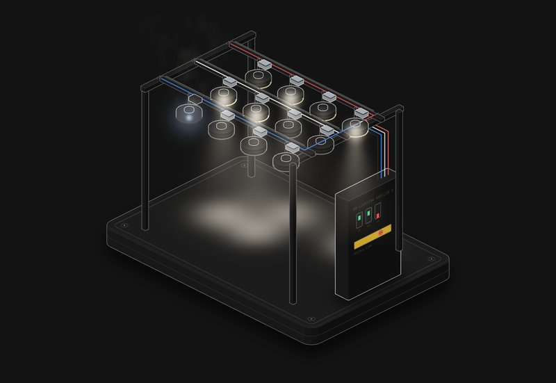

# Lost neutral

Twelve LED high bays in three rows, one row per phase, all sharing one neutral back to the lighting board. Loosen the neutral, break it, change how many lights are on per row, and see what happens to the drivers.

**[▶ Play with it](https://dizzyfer.github.io/Anatomy/lost-neutral/)** · [light version](https://dizzyfer.github.io/Anatomy/lost-neutral/light.html) · [all figures](https://dizzyfer.github.io/Anatomy/)

## How it works

1. **With the neutral connected,** every row gets its 230 V no matter what the others are doing. The neutral carries the out-of-balance current home.
2. **Lose the neutral** and the rows' common point (the star point) is no longer held at 0 V. It floats toward the most heavily loaded row. That row's voltage drops and the lightly loaded row's climbs toward 400 V.
3. **The drivers:** too little voltage and they drop out or flicker. Too much and the surge MOV cooks, fails short and trips that row's breaker.
4. **Then it cascades.** With one row tripped and no neutral, the other two rows are in series across 400 V, split by how much each draws.

## The sneaky bits

- **Balanced loads hide it.** Break the neutral with all three rows equally loaded and nothing looks wrong. Switch one row down and it all goes.
- **A loose neutral is worse than a clean break:** it makes and breaks, the lights flicker and surge, and the joint cooks on the neutral current. That's how most lost neutrals start.
- **Wide-range drivers** (90 to 305 V) ride through a moderate imbalance that kills narrow 198 to 264 V ones. Nothing survives a big one.

## What you can do

- **Neutral:** solid, loose, broken. **Drivers:** narrow or wide range. **Lights on:** 0 to 4 per row.
- A voltage meter per row with the 216 to 253 V band and the driver's max, plus how far the star point has shifted, the neutral current, the joint's heat and how many drivers are dead.
- Tap the gantry to break and fix the neutral, **Replace dead drivers**, Slow-mo and Demo tour like the others.

Keyboard: Space = break/fix, N = solid/loose/broken, 1 2 3 = lights per row, W = drivers, R = replace, S = slow-mo.

## The numbers

Real: 400/230 V three-phase four-wire, AS 60038's 230 V +10 %/−6 % (216 to 253 V), the floating star point (Millman's theorem), and typical driver input ranges of 198 to 264 V for narrow drivers and 90 to 305 V for wide-range ones (Mean Well HLG style).

Made up for the toy: 150 W fittings treated as fixed loads while running (real constant-power drivers can make it worse), where they drop out, how fast they die above their rating, the MOV failing short and tripping the row, and how the loose joint behaves. Don't design a lighting board off it.

## How it's built

Built with [**Anatomy**](https://github.com/wheresryan22/anatomy) by Ryan (wheresryan22). To rebuild, drop `src/build.mjs` into Anatomy as `examples/lost-neutral/build.mjs` and run `node build.mjs` (`--light` for the light theme).
