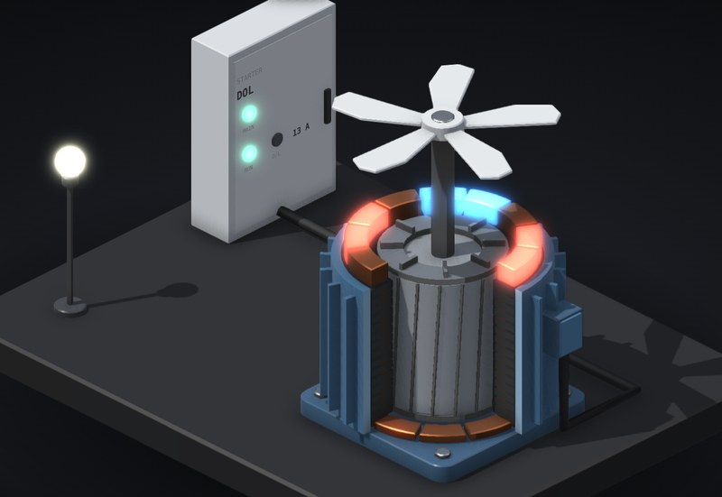

# How a motor starts

A 7.5 kW induction motor cut open, with a fan on the shaft, a starter panel and a light on the same supply. Start it direct on line, star-delta or on a VFD, give it an easy load, a hard one or a jammed one, and watch the current.

**[▶ Play with it](https://dizzyfer.github.io/Anatomy/motor/)** · [light version](https://dizzyfer.github.io/Anatomy/motor/light.html) · [all figures](https://dizzyfer.github.io/Anatomy/)

## How it works

1. **The field goes round.** Three phases in three sets of windings make a magnetic field that rotates at 1500 rpm on a 4-pole motor at 50 Hz. The red and blue on the windings are its N and S poles going round (shown 40× slower).
2. **The rotor chases it.** The rotor is just bars shorted at the ends. It only gets current, and so torque, when the field is slipping past it. That's why it runs a bit under 1500: about 2.5 % slip at full load.
3. **At standstill the slip is total.** So started direct on line, it pulls 7 to 8 times its full load current until it gets up to speed. The light on the same board dips.

## The three starters

- **Direct on line:** full voltage, full inrush, full torque. Simple and brutal.
- **Star-delta:** each winding gets 240 V instead of 415, so a third of the current, but also a third of the torque. Fine on a fan. On a loaded conveyor it can't break away in star, the timer doesn't know, and the switch to delta hits it with the full locked rotor current anyway.
- **VFD:** starts the field slowly and ramps it up with the rotor, so the slip, and the current, never get big.

## Jam it

A jammed rotor turns all that current into heat. This motor can stand a locked rotor for about 12 s from cold. A class 10 overload has to trip at 7.2 × its setting within 4 to 10 s, so it wins the race. Bypass it and the windings go past 155 °C (class F), the insulation cooks, and it lets the smoke out. On a VFD the drive holds 1.5 × In and trips on stall.

## What you can do

- **Starter:** direct on line, star-delta, VFD. **Load:** fan, loaded conveyor, jammed. **Overload:** set or bypassed.
- A scope with current and speed over the last 10 s, winding temperature (155 °C mark), supply voltage, and speed, current and torque against the load.
- **START / STOP** (or tap the motor), **Rewind it** after you burn it. Slow-mo and Demo tour like the others.

Keyboard: Space = start/stop, 1 2 3 = starter, F C J = load, O = overload, R = rewind, S = slow-mo.

## The numbers

Real, from the WEG W22 IE3 7.5 kW 4-pole (132M) datasheet: 14.2 A at 400 V, 1460 rpm, locked rotor current 8.3 × In, locked rotor torque 2.4 × Tn, breakdown torque 3.5 × Tn, class F, locked rotor time 12 s cold. Class 10 overload: trips at 7.2 × in 4 to 10 s. Star: a third of the current and torque.

Made up for the toy: the equivalent circuit (fitted to those ratios), the loads and their inertia, the star-delta timer, the drive settings, the supply dip, the thermal model and the burnout temperature. Don't size anything off it.

## How it's built

Mark II: drawn in real 3D with a small WebGL2 renderer (`mk2/engine.mjs` in this repo: soft shadows, ambient occlusion, ink outlines, bloom, x-ray), on top of the camera and page conventions of [**Anatomy**](https://github.com/wheresryan22/anatomy) by Ryan (wheresryan22). Drag to rotate, pinch or ctrl-scroll to zoom, double click to reset the view. To rebuild, copy this repo's `mk2/` folder into an Anatomy checkout, drop `src/build.mjs` in as `examples/motor/build.mjs` and run `node build.mjs` (`--light` for the light theme).
