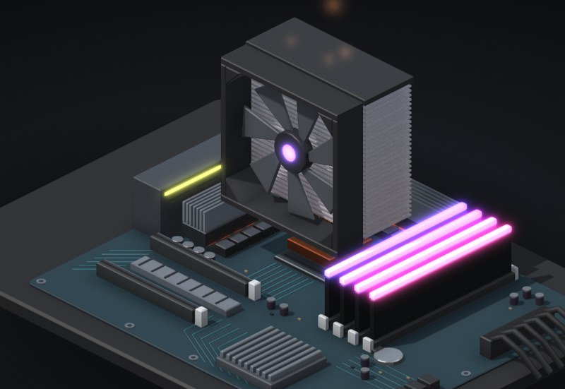

# Overclocking a CPU

A desktop board on a test bench. Push the clock, feed it voltage, swap coolers up to a liquid nitrogen pot, chase the render score, and find out what happens when you turn the safeties off.

**[▶ Play with it](https://dizzyfer.github.io/Anatomy/overclock/)** · [light version](https://dizzyfer.github.io/Anatomy/overclock/light.html) · [all figures](https://dizzyfer.github.io/Anatomy/)

## How it works

1. **Clock needs voltage.** More clock means each transistor has less time to switch, so it needs more voltage. Too little and it makes errors: a blue screen, usually CLOCK_WATCHDOG_TIMEOUT or WHEA_UNCORRECTABLE_ERROR.
2. **Power is voltage squared.** Power goes up with the clock and with the square of the voltage, and the voltage droops under heavy load, so a setting that renders fine can fall over in an AVX stress test.
3. **Heat makes more heat.** A hot chip leaks more current, which makes it hotter. At 95 °C it throttles itself, at 115 °C it trips off.
4. **The wall.** Past a certain clock the voltage a chip needs shoots up. Cold pushes that wall out, which is why the record runs are done on liquid nitrogen (it boils at -196 °C).
5. **Every chip is different.** That's the silicon lottery. Some also stop working when they get too cold: the cold bug.
6. **Voltage plus heat wears it out.** High voltage at high temperature slowly wears through the chip's wiring (electromigration). It doesn't heal.
7. **The VRM has limits too.** The power stages next to the socket have an over-current limit. Turn the safeties off and push enough current through them, and they let go.

## What you can do

- **Clock** (multiplier × 100 MHz) and **Vcore** sliders.
- **Cooler:** stock, tower, 240 mm AIO, or an LN2 pot (with a pot temperature to hold).
- **Load:** idle, gaming, render (scores) or AVX stress (hottest).
- Meters for temperature, power and current, your voltage margin, and chip health. The monitor shows the render, the blue screen or no signal, and the debug display on the board shows the CPU temperature or an error code.
- **Safeties on/off**, **New chip** (silicon lottery), **Back to stock**, Slow-mo and Demo tour like the others.

Keyboard: up/down = clock, left/right = voltage, 1 to 4 = cooler, S = slow-mo.

## The numbers

Real: power with voltage squared times clock, leakage rising with temperature, throttling and a thermal trip, the voltage wall and cold pushing it out, liquid nitrogen at -196 °C, the silicon lottery, the cold bug, voltage droop under load, VRM over-current protection, the blue screen stop codes, and wear from high voltage and heat. The real CPU frequency record is about 9.2 GHz, set in 2026 on liquid helium.

Made up for the toy: the chip, every number in the model, the score, the debug codes and the time scale (temperatures settle in seconds, a render takes eight). Don't put 1.65 V through your own CPU.

## How it's built

Mark II: drawn in real 3D with a small WebGL2 renderer (`mk2/engine.mjs` in this repo: soft shadows, ambient occlusion, ink outlines, bloom, x-ray), on top of the camera and page conventions of [**Anatomy**](https://github.com/wheresryan22/anatomy) by Ryan (wheresryan22). Drag to rotate, pinch or ctrl-scroll to zoom, double click to reset the view. To rebuild, copy this repo's `mk2/` folder into an Anatomy checkout, drop `src/build.mjs` in as `examples/overclock/build.mjs` and run `node build.mjs` (`--light` for the light theme).
