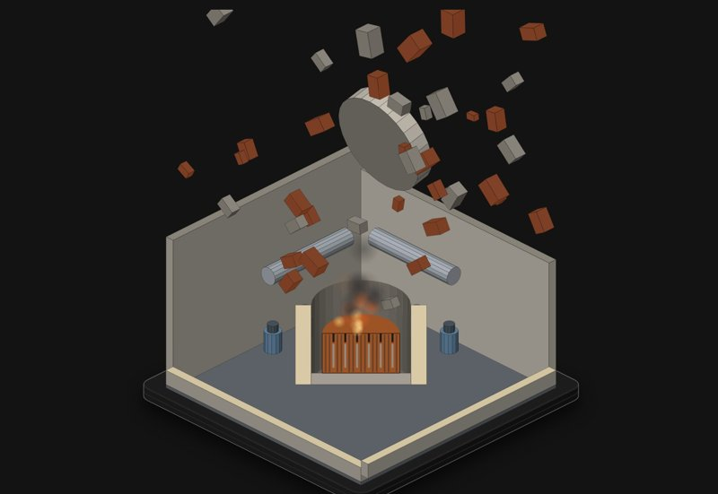

# Nuclear reactor

Two reactors, one toggle. Chernobyl's RBMK-1000 in its plain industrial building, and a modern pressurised water reactor in its containment, both cut in half. Do the same things to both and see which one forgives you.

**[▶ Play with it](https://dizzyfer.github.io/Anatomy/reactor/)** · [light version](https://dizzyfer.github.io/Anatomy/reactor/light.html) · [all figures](https://dizzyfer.github.io/Anatomy/)

## How it works

1. **Chain reaction.** Fission frees neutrons, a moderator slows them, slow ones split the next atoms. Control rods soak neutrons up.
2. **Delayed neutrons make it controllable.** About 0.65 % of neutrons come out seconds late. Add more reactivity than that (one dollar) and the reaction is **prompt critical**: it runs away in milliseconds.
3. **Feedback keeps it safe, or doesn't.** Hotter fuel absorbs more (Doppler, always negative). In a **PWR** the water is the moderator, so heat or steam slows the reaction: negative void coefficient. In the **RBMK** graphite moderates and water mostly absorbs, so steam speeds it up: at low power with the rods out the void coefficient goes strongly positive.
4. **Xenon.** Cut power and xenon-135 piles up for hours, eating neutrons. Pulling rods to fight it drains the operating reactivity margin.
5. **The positive scram.** RBMK rods had graphite tips. Driving fully withdrawn rods in pushed water out of the bottom of the core first, adding reactivity for a few seconds.
6. **Decay heat.** After shutdown the fission products still make several percent of full power. No cooling, and the core melts anyway. That's what containment is for.

## What you can do

- Switch between **RBMK-1000** and **PWR**.
- **Rods** and **pumps** sliders; **AZ-5 / SCRAM**, **trip the pumps**, **wait an hour** for the xenon, **safety systems** on or off.
- **Run the 1986 test**: the Chernobyl 4 sequence from the low-power state to AZ-5.
- Meters for power (log), reactivity in dollars with the prompt-critical line, fuel temperature, steam, xenon, and the RBMK's operating reactivity margin or the PWR's containment pressure. Neutrons dart around the cut face of the core.

Keyboard: up/down = rods, S = scram, P = trip pumps, T = swap reactors.

## The numbers

Real: point kinetics with delayed neutrons and the one-dollar line, Doppler, the RBMK's positive void coefficient at low power and low margin against a PWR's negative one, xenon-135, the graphite-tipped rods (positive scram), decay heat and containment. The 1986 sequence follows [World Nuclear Association's timeline](https://world-nuclear.org/information-library/safety-and-security/safety-of-plants/appendices/chernobyl-accident-appendix-1-sequence-of-events): power fell to about 30 MWt, back to about 200 MWt, margin at 8 rods against a minimum of 15, emergency cooling isolated, test at 01:23:04, AZ-5 at 01:23:40. Three Mile Island (1979) was a meltdown the containment held.

Made up for the toy: one delayed group and every coefficient, sped-up xenon, decay heat and melting, simplified geometry (the PWR vessel is drawn bigger than life), and the explosion.

## How it's built

Built with [**Anatomy**](https://github.com/wheresryan22/anatomy) by Ryan (wheresryan22). To rebuild, drop `src/build.mjs` and `src/solid.mjs` into Anatomy as `examples/reactor/` and run `node build.mjs` (`--light` for the light theme).
