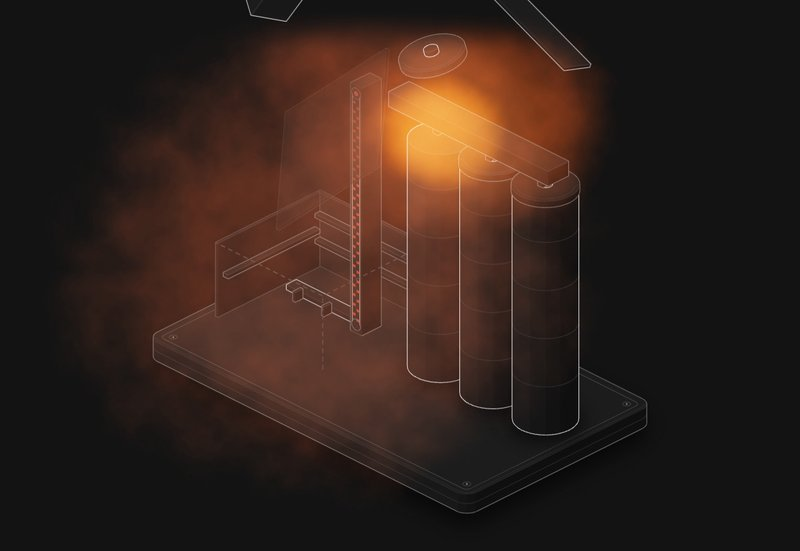

# Grain dust explosion

A grain plant: a receiving building, a bucket elevator, a headhouse, a gallery and three silos. Let a bearing run hot and see whether you get one small bang or the whole plant.

**[▶ Play with it](https://dizzyfer.github.io/Anatomy/silo/)** · [light version](https://dizzyfer.github.io/Anatomy/silo/light.html) · [all figures](https://dizzyfer.github.io/Anatomy/)

## How it works

1. **The primary** is usually small and inside equipment: a hot bearing or a slipping belt lights the dust cloud inside the bucket elevator.
2. **The secondary** is the killer. The primary's pressure wave shakes the whole building and throws the dust that's settled on beams, ledges and floors into the air, and the primary's flame lights it. It runs through the receiving building, the headhouse, the gallery and into the silos.
3. **How much dust is too much:** NFPA 654 treats about 0.8 mm (1/32 in, roughly a paperclip wire) over more than 5 % of the floor as an explosion hazard. OSHA's grain handling rule caps priority areas at 3.2 mm (1/8 in).

## The protections

- **Monitoring:** bearing temperature (and belt alignment) sensors stop the elevator before anything ignites.
- **Explosion vents on the leg:** they take the punch out of the primary and throw the fireball outside.
- **Isolation:** chokes and flap valves stop the flame running down the spouts into the silos.
- **Housekeeping:** takes away the fuel for the secondary. Nothing else does.

## What you can do

- **Dust** layer (0 to 4 mm, with the 0.8 and 3.2 mm lines), **Monitoring** on or off, **Leg** vented or not, **Silos** isolated or open.
- **HOT BEARING** (or tap the plant) and watch the bearing meter climb. Slow-mo and Demo tour like the others.

Keyboard: Space = hot bearing, ↑ ↓ = dust, M = monitoring, V = vents, I = isolation, S = slow-mo.

## The numbers

Real: primary and secondary dust explosions, NFPA 654's 0.8 mm over 5 % of the floor (for dust around 1200 kg/m³), OSHA's 3.2 mm for priority areas in grain handling, and monitoring, venting and isolation as protections.

Made up for the toy: how much dust it takes here, the timings, the fireballs and what flies where. Do a proper dust hazard analysis.

## How it's built

Built with [**Anatomy**](https://github.com/wheresryan22/anatomy) by Ryan (wheresryan22). To rebuild, drop `src/build.mjs` into Anatomy as `examples/silo/build.mjs` and run `node build.mjs` (`--light` for the light theme).
