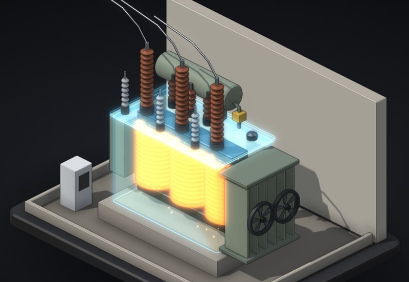

# Power transformer

A 60 MVA, 132/33 kV oil-filled transformer in a substation bay, tank you can x-ray. Load it up in a heatwave, kill the fans, hit it with a feeder fault or lightning, and see whether the protection gets there first.

**[▶ Play with it](https://dizzyfer.github.io/Anatomy/transformer/)** · [light version](https://dizzyfer.github.io/Anatomy/transformer/light.html) · [all figures](https://dizzyfer.github.io/Anatomy/)

## How it works

1. **Heat.** Load current heats the windings. The oil carries the heat up and across to the radiators, cools, sinks and comes back round; fans push more air when it's busy (ONAN/ONAF).
2. **Hot-spot and the paper.** The hottest bit of winding sets how fast the paper insulation ages: about double for every 6 °C over 98 °C, against a 180,000 h normal life (IEC 60076-7). Past about 140 °C the paper starts making gas bubbles.
3. **Through-faults.** A short on a feeder pushes several times rated current through the windings. The force goes with current squared. Cleared fast it's a thump; cleared slow it bends the windings.
4. **Internal faults.** An arc in oil makes gas fast. The Buchholz relay catches the gas, differential protection (87T) sees current going in that doesn't come out, and the breakers open in tens of milliseconds.
5. **When nothing trips.** The arc keeps boiling oil into gas, the pressure beats the relief device, the tank splits and the oil burns. That's why there's a firewall and a bund.

## What you can do

- **Load** (0 to 200 %) and **ambient** temperature sliders.
- **Fans** OK or failed, **surge arresters** fitted or not, **protection** on or off.
- **Feeder fault** (cleared in 100 ms), **stuck breaker** (cleared in 1.5 s), **lightning** on the 132 kV line.
- Meters for top oil, hot-spot (98 °C normal, 140 °C bubbles), ageing rate, and gas/tank pressure; paper life used and dissolved acetylene.
- Reset, Slow-mo and Demo tour.

Keyboard: up/down = load, F = fans, T = feeder fault, L = lightning, P = protection, S = slow-mo.

## The numbers

Real: the IEC 60076-7 thermal model shape, the ageing law and 180,000 h normal life, bubbling above about 140 °C, ONAN/ONAF, short-circuit forces with current squared, Buchholz, differential and surge-arrester protection, tank rupture and oil fire, firewalls and bunds.

Typical rather than from a real site: the unit rating, the alarm and trip settings, the fault level. Made up: time runs 300× fast, the gas and pressure model, and the explosion.

## How it's built

Mark II: drawn in real 3D with a small WebGL2 renderer (`mk2/engine.mjs` in this repo: soft shadows, ambient occlusion, ink outlines, bloom, x-ray), on top of the camera and page conventions of [**Anatomy**](https://github.com/wheresryan22/anatomy) by Ryan (wheresryan22). Drag to rotate, pinch or ctrl-scroll to zoom, double click to reset the view. To rebuild, copy this repo's `mk2/` folder into an Anatomy checkout, drop `src/build.mjs` in as `examples/transformer/build.mjs` and run `node build.mjs` (`--light` for the light theme).
