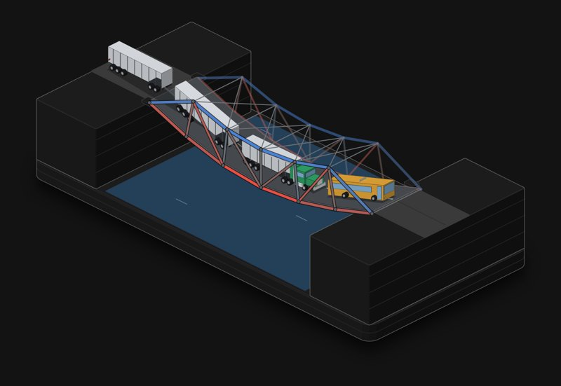

# Truss bridge

A 48 m steel truss bridge over a river. Send cars, buses, B-doubles, road trains or a mining haul truck across and watch the forces move through the members. Cut one and see what happens.

**[▶ Play with it](https://dizzyfer.github.io/Anatomy/truss/)** · [light version](https://dizzyfer.github.io/Anatomy/truss/light.html) · [all figures](https://dizzyfer.github.io/Anatomy/)

## How it works

1. **Push and pull only.** A pin-jointed truss turns the load into pure tension and compression along straight members. Red is tension, blue is compression, and the brighter the member the closer it is to its limit.
2. **Chords and diagonals.** Under load the bottom chord stretches, the top chord squashes, and the diagonals near the load hand it out to the supports.
3. **Compression is the weak side.** Steel is as strong pulling as pushing, but a long, thin member in compression buckles (Euler) well before the steel yields.
4. **Pratt against Howe.** Same steel, same span. A Pratt truss puts its long diagonals in tension, a Howe puts them in compression. Here the Pratt carries a road train at about 85 % and the Howe buckles under it.
5. **No spare members.** This truss is statically determinate: every member is needed. Lose one, by overload or by cutting it, and it's a mechanism. Down it goes.

The forces come from a real direct-stiffness solve every frame, with each axle's load split to the joints either side.

## What you can do

- **Send** a car (1.5 t), bus (18 t), B-double (62.5 t), road train (about 120 t) or haul truck (about 620 t).
- **Stream of cars**, or **Jam on the bridge** to stop traffic on the span with its full weight sitting there.
- Switch between **Pratt** and **Howe**. Tap any member to cut it.
- Meters for the worst member (100 % and it goes) and the tonnes on the span. New bridge, Slow-mo and Demo tour like the others.

Keyboard: 1 to 5 send a vehicle, J = jam, H = Pratt/Howe, R = new bridge, S = slow-mo.

## The numbers

Real: the stiffness method for a pin-jointed truss, tension and compression, Euler buckling, Pratt against Howe, and a determinate truss becoming a mechanism. Typical Australian vehicle masses: B-double 62.5 t, triple road train about 120 t, a big loaded mining haul truck about 620 t.

Made up for the toy: the member sizes, the dead load, the speeds, no impact or lane factors, and the sag drawn 80 times bigger (dead-load sag left out, as if the bridge were cambered). Not a bridge design.

## How it's built

Built with [**Anatomy**](https://github.com/wheresryan22/anatomy) by Ryan (wheresryan22). To rebuild, drop `src/build.mjs` and `src/solver.js` into Anatomy as `examples/truss/` and run `node build.mjs` (`--light` for the light theme).
