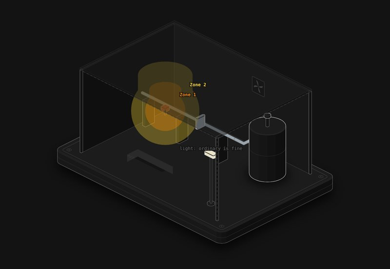

# Hazardous area zones

A small process area with a flange, a sample point and a tank vent. Pick the release, the gas, the leak size, where it is and how reliable the ventilation is, and watch the zone come out of the table and the envelope grow around it.

**[▶ Play with it](https://dizzyfer.github.io/Anatomy/zones/)** · [light version](https://dizzyfer.github.io/Anatomy/zones/light.html) · [all figures](https://dizzyfer.github.io/Anatomy/)

## How it works

A zone comes from three things:

1. **Grade of release:** continuous (all the time), primary (in normal operation) or secondary (only when something goes wrong, and not for long).
2. **Degree of dilution:** how fast the air carries the gas off compared with how fast it comes out. High, medium or low.
3. **Availability of the ventilation:** good, fair or poor.

Put them through the table (after IEC 60079-10-1 Table D.1) and you get the zone. The table sits under the figure and the cell you're in lights up. The size of the cloud sets the extent.

## Things to try

- **A small flange leak in open air:** high dilution, so it's a zone of negligible extent and non-hazardous in practice.
- **Same leak, bigger, under a shelter, then indoors:** dilution drops, the envelope grows, and at low dilution indoors it fills the room and goes up to Zone 1.
- **Sample point with fair availability:** Zone 1 surrounded by Zone 2, for the times the ventilation isn't working.
- **Heavier than air:** it slumps to the ground and spreads, and the pit collects it.
- **The light on the pole** tells you the EPL it needs: Ga in Zone 0, Ga or Gb in Zone 1, Ga, Gb or Gc in Zone 2.

Keyboard: Space = next release, G = gas, W = where, A = availability, ↑ ↓ = leak size.

## The numbers

Real: the grade, dilution and availability method, the zone table after IEC 60079-10-1:2020 Table D.1, and the zone-to-EPL rule from IEC 60079-14.

Made up for the toy: how dilution is worked out (a stand-in for Figure C.1), the envelope sizes and shapes (a stand-in for Figure D.1, so no distances are shown), and the pit rule (common practice, not the table). Do a real classification.

## How it's built

Built with [**Anatomy**](https://github.com/wheresryan22/anatomy) by Ryan (wheresryan22). To rebuild, drop `src/build.mjs` into Anatomy as `examples/zones/build.mjs` and run `node build.mjs` (`--light` for the light theme).
